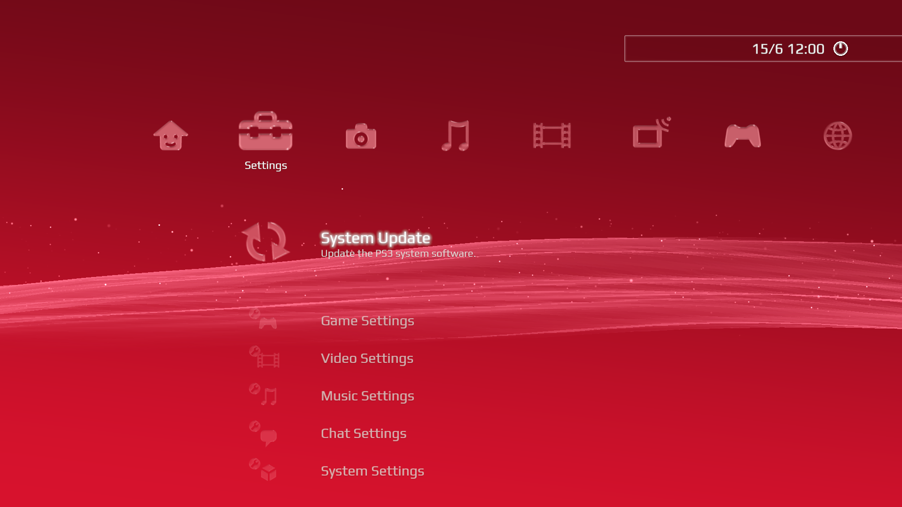
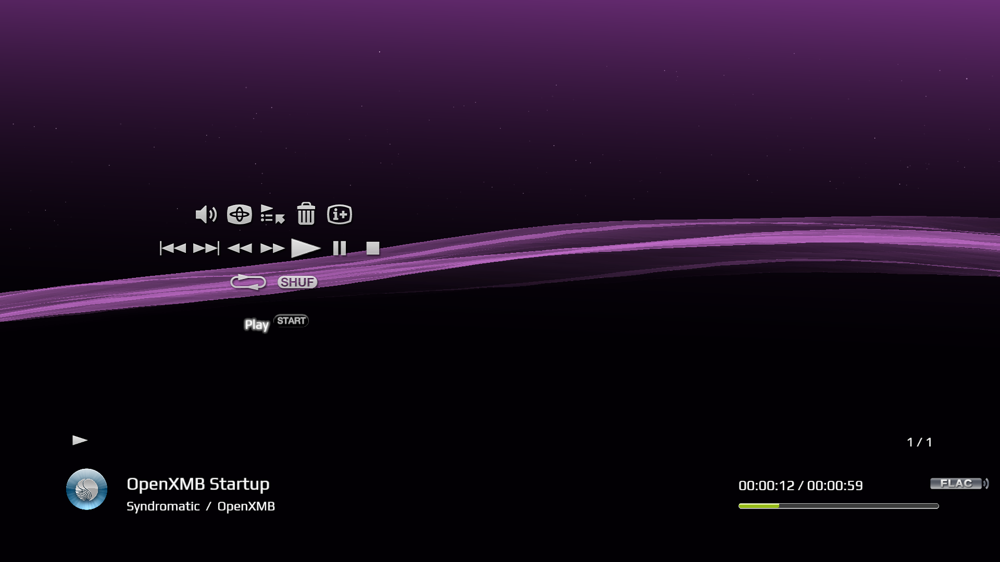

# OpenXMB

<p align="left">
  An open-source, cross-platform reimagining of Sony's XrossMediaBar, built with modern C++23, Vulkan, and SDL2 for high performance and portable efficiency.
</p>
<a href="https://syndromatic.com"></a>

## About The Project

This project is a modern interpretation of the iconic XrossMediaBar (XMB) interface, famously used on the PlayStation 3 and other Sony devices. It is not a direct port, but a new implementation that leverages modern graphics APIs and C++ features to create a flexible and performant user interface for desktops and embedded systems.

The rendering backend is powered by [**AuroreEngine**](https://github.com/phenom64/AuroreEngine), a custom rendering library based on `dreamrender`. The entire application is built using C++23 modules for a clean and modern architecture.

## Screenshots

<p align="center">
  
  
</p>

<p align="center">
  <em>Left: Home menu and settings · Right: Music playback and visualizer</em>
</p>

## Features

*   **Modern Tech Stack:** Built with C++23 modules, CMake, Vulkan for rendering (with MoltenVK on macOS), and SDL2 for windowing and input.
*   **Cross-Platform:** Designed to run on SynOS (and other Ubuntu-based distros), macOS, and Windows.
*   **Dynamic XMB Interface:** A fully navigable, PS3-style cross-media bar with smooth animations and a dynamic wave background.
*   **Extensible Menus:** Includes menus for Settings, Photos, Music, Videos, Games, and Applications. The application menu automatically scans for `.desktop` files.
*   **Built-in Media Viewers:**
    *   Image viewer for common formats.
    *   Text viewer.
    *   FFmpeg-based video player with GPU YUV conversion.
*   **Highly Configurable:** Runtime behavior, colors, fonts, and more can be configured via a simple `config.json` file.
*   **Optional Modules:** The build system allows enabling or disabling major features like the video player, an optional WebKitGTK browser surface, and libretro core support.

## Getting Started

### Prerequisites

Before you begin, ensure you have the following tools and libraries installed (versions are minimums unless stated):

- Git
- CMake 3.28+
- Ninja build system
- C++23-capable compiler:
  - Linux: Clang 17+ (Clang 19 recommended) or GCC 13+
  - macOS: Homebrew LLVM/Clang with `clang-scan-deps` + Vulkan loader/MoltenVK packages
  - Windows: LLVM/Clang with `clang-scan-deps` (MSVC support is blocked by the current `#embed` shader/resource path)
- Vulkan 1.2 capable GPU + drivers (MoltenVK on macOS)
- Libraries (names as found on Ubuntu 24.04-like distros):
  - Vulkan headers and loader: `libvulkan-dev`, `vulkan-utility-libraries-dev`
  - SDL2 core + image + mixer: `libsdl2-dev`, `libsdl2-image-dev`, `libsdl2-mixer-dev`
  - FFmpeg (music, previews and optional video): `libavcodec-dev libavformat-dev libavutil-dev libswscale-dev libswresample-dev`
  - Freetype: `libfreetype-dev`
  - glm: `libglm-dev`
  - fmt: `libfmt-dev`
  - gettext (i18n): `gettext`
  - Theme/comic archives: `libarchive-dev`, `zlib1g-dev`
  - Linux desktop integration: `libx11-dev`, `libxtst6`
  - Optional embedded Linux browser: `libwebkit2gtk-4.1-dev`, `libgtk-3-dev`
  - PDF viewing: Poppler tools (`pdfinfo`, `pdftoppm`); printing uses `lp` or `lpr`
  - Optional online game metadata: libcurl and a user-supplied provider key
- Optional (used by dependencies): `harfbuzz`, `glslang-tools`, `spirv-tools`, `pkg-config`

See [desktop workflows and validation](docs/desktop-release.md) for the expanded shell, themes and native media tools.

### Build Instructions

The default preset builds a Release configuration with native desktop media, browser, disc and emulation integrations enabled:

```bash
cmake --preset default
cmake --build --preset default
```

For editor/debug work, use `cmake --preset dev && cmake --build --preset dev`.

#### macOS

1.  **Install Dependencies (via Homebrew):**
    ```bash
    brew install cmake ninja pkg-config llvm ffmpeg sdl2 sdl2_image sdl2_mixer gettext fmt freetype glm
    # Install Vulkan loader, shader tools, and MoltenVK
    brew install vulkan-loader glslang molten-vk
    ```

2.  **Build OpenXMB:**
    ```bash
    # Clone the repository
    git clone https://github.com/phenom64/OpenXMB.git
    cd OpenXMB

    # Configure and build the project
    LLVM_PREFIX=$(brew --prefix llvm)
    CC="$LLVM_PREFIX/bin/clang" CXX="$LLVM_PREFIX/bin/clang++" cmake --preset default
    cmake --build --preset default

    # (Optional) Install the application
    # This will place the binary and assets in the specified directory.
    cmake --install build/default --prefix "/Applications/OpenXMB"
    ```
    The launcher script will automatically try to locate the `MoltenVK_icd.json` file required for Vulkan to work on macOS.

#### SynOS / Ubuntu-based Distributions

1.  **Install Dependencies (via APT):**
    ```bash
    sudo apt update
    sudo apt install build-essential git cmake ninja-build pkg-config \
        clang-18 clang-tools-18 libvulkan-dev vulkan-utility-libraries-dev glslang-tools spirv-tools \
        libsdl2-dev libsdl2-image-dev libsdl2-mixer-dev \
        libavcodec-dev libavformat-dev libavutil-dev libswscale-dev libswresample-dev \
        libglm-dev libfreetype-dev gettext libfmt-dev libarchive-dev zlib1g-dev \
        libx11-dev libxtst6 poppler-utils
    ```

2.  **Build OpenXMB:**
    ```bash
    # Clone the repository
    git clone https://github.com/phenom64/OpenXMB.git
    cd OpenXMB

    # Configure and build the project
    CC=clang-18 CXX=clang++-18 cmake --preset default
    cmake --build --preset default

    # (Optional) Install the application system-wide
    sudo cmake --install build/default
    ```

#### Windows

1.  **Install Dependencies:**
    *   **LLVM/Clang:** Install LLVM and ensure `clang++` and `clang-scan-deps` are in your PATH. The current Windows build uses Clang/Ninja because the shader/resource embedding path is not MSVC-compatible yet.
    *   **Visual Studio 2022 Build Tools:** Install the "Desktop development with C++" workload for the Windows SDK, linker/runtime pieces, and platform libraries.
    *   **Git, CMake 3.28+, Ninja:** Install these tools and ensure they are in your PATH.
    *   **Vulkan SDK:** Download and install from the [LunarG website](https://vulkan.lunarg.com/).
    *   **vcpkg:** Set `VCPKG_ROOT` to your vcpkg checkout. The manifest and presets require SDL2's Vulkan feature; if installing dependencies explicitly, use:
      ```powershell
      # Clone and set up vcpkg
      git clone https://github.com/microsoft/vcpkg.git
      cd vcpkg
      ./bootstrap-vcpkg.bat
      ./vcpkg integrate install

      # Install dependencies
      ./vcpkg install "sdl2[vulkan]" sdl2-image sdl2-mixer ffmpeg freetype glm fmt gettext harfbuzz pkgconf --triplet x64-windows
      ```

2.  **Build OpenXMB:**
    ```powershell
    # Clone the repository
    git clone https://github.com/phenom64/OpenXMB.git
    cd OpenXMB

    # Point the preset at vcpkg
    $env:VCPKG_ROOT = "<path-to-vcpkg>"
    cmake --preset windows-vcpkg

    # Build the project
    cmake --build --preset windows-vcpkg

    # (Optional) Install the application
    cmake --install build/windows-vcpkg --prefix "C:/OpenXMB"
    ```
    When developing OpenXMB and AuroreEngine together, use `windows-local-aurore` or pass `-DAUROREENGINE_LOCAL=<path-to-AuroreEngine>` so OpenXMB builds against your local engine checkout.

### Build Options

The default preset enables desktop integrations. Direct CMake builds use the following options and defaults:

*   `-DENABLE_VIDEO_PLAYER=ON/OFF`: Enable the FFmpeg-based video player (Default: ON)
*   `-DENABLE_BROWSER=ON/OFF`: Enable desktop browser integration (Default: OFF)
*   `-DENABLE_DISC_MEDIA=ON/OFF`: Enable DVD/Blu-ray support [ALPHA] (Default: OFF)
*   `-DENABLE_LIBRETRO=ON/OFF`: Enable the libretro core host for emulation [ALPHA] (Default: OFF)
*   `-DINTERFACE_FX_DEBUG=ON/OFF`: Enable interface/UI graphics+text debug overlays (Default: OFF)
*   `-DOPENXMB_APPLE_PREFIXES=/path/a;/path/b`: Add macOS package-manager prefixes if dependencies are not in the usual Homebrew locations.

Example: `cmake -B build -DENABLE_BROWSER=ON`

Recommended one-liner after selecting the compiler for Linux/macOS:

```bash
cmake --preset default && cmake --build --preset default
```

For CI or packaging checks, run the headless staged-install smoke script:

```bash
scripts/headless-smoke.sh
```

It configures, builds, installs into `build/ci/stage`, and verifies the launcher, binary, default config, font, representative icons, and OK sound were staged.
On Windows, use the `windows-vcpkg` preset and verify both a windowed launch and an app-local install layout.

## Configuration

OpenXMB stores settings in `config.json`. The active profile has its own settings;
setting `OPENXMB_CONFIG` selects an explicit configuration file instead of restoring
the active profile at startup. Without an override, OpenXMB loads saved user
settings before falling back to packaged defaults. It saves changes to the active
profile or explicit file, or to the user configuration directory when neither is
selected. Default user configuration locations are `~/.config/openxmb` on Linux
(or `$XDG_CONFIG_HOME/openxmb`), `~/Library/Application Support/OpenXMB` on
macOS and `%LOCALAPPDATA%/OpenXMB` on Windows.

You can change settings such as:

*   Background colors and type (`wave`, `color`, `image`)
*   Fonts and date/time display
*   Controller settings
*   Render quality (VSync, MSAA, FPS limit)

The Unix launcher sets `XMB_ASSET_DIR` and `XMB_LOCALE_DIR` when they are not already provided. Windows build-tree and install runs use an app-local layout beside `XMS.bin.exe`, with `shell` for assets and `locales` for gettext catalogs.

## Roadmap

| Milestone | Status | Remaining work |
| --- | --- | --- |
| M1: Shell and configuration | ✅ Implemented | Platform installation and runtime validation. |
| M2: Menus, fonts and icons | ✅ Implemented | Continue visual and platform refinements. |
| M3: Music and visualizer | ✅ Implemented | Expand audio management and validate sustained playback. |
| M4: Video player | 🏗️ Partially implemented | Add hardware decoding and bitmap subtitles. |
| M5: Emulation | 🏗️ Partially implemented | Extend software libretro support to hardware-context cores. |
| M6: Browser | 🏗️ Partially implemented | Expand platform support and validate native Wayland input. |
| M7: Disc media | 🏗️ Partially implemented | Expand optical-device and format coverage. |
| M8: Performance and release | 🏗️ Partially implemented | Complete release checks and target-hardware measurements. |

OpenGL ES, H700/RG34XX support and a handheld distribution are deferred. See
[milestones.txt](milestones.txt) and [desktop workflows](docs/desktop-release.md)
for details.

### Notes on AuroreEngine

OpenXMB uses AuroreEngine as the rendering backend. By default, the build fetches it automatically. For development or local changes, use the `windows-local-aurore` preset on Windows or point CMake to a local checkout with `-DAUROREENGINE_LOCAL=/path/to/AuroreEngine`.

## License

OpenXMB is distributed under the **GNU General Public License v3.0 (GPLv3)**.  
See the [LICENSE](LICENSE) file for the full text.

A significant portion of the OpenXMB base is derived from **XMBShell**, and this is reflected in code taken from that project.  
Many thanks to its author, **JCM**.

All other original code is © 2025-2026 Syndromatic Ltd and contributors, and licensed under version 3 of the GNU General Public License.
AuroreEngine components adapted from **dreamrender** remain under the MPL 2.0 license.

---

## Acknowledgements

OpenXMB incorporates work from several outstanding open-source projects:

* **[XMBShell](https://github.com/JnCrMx/xmbshell)** – significant portions of OpenXMB are derived from XMBShell, originally created by JCM.  
* **[RetroArch](https://github.com/libretro/RetroArch)** – portions of the codebase are reused for media and emulation functionality.  
* **[dreamrender](https://github.com/JnCrMx/dreamrender)** – AuroreEngine, the rendering backend, is based on dreamrender.  

And of course, thanks to the wider ecosystem, including:  
* SDL2  
* Vulkan  
* FFmpeg  
* Freetype  
* glm  
* spdlog  
* i18n-cpp  
* nlohmann/json  
* argparse  
